<div align="center">

  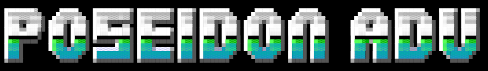

  <h1>POSEIDON: ADVANCED</h1>
  <p><b>Sharks swim but Poseidon rules the (RF)waves!</b></p>
  <p><i>Educational RF / embedded security lab for the M5Stack Cardputer-Advance — authorized use on owned hardware only</i></p>

  [](https://github.com/wilcox101-maker/poseidon_adv/actions/workflows/build.yml)
  [](https://m5stack.com)
  [](https://platformio.org/)
  [](LICENSE)
  [](FEATURES.md)
  [](https://github.com/wilcox101-maker/poseidon_adv)
  [](CHANGELOG.md)
  [](#safety--authorized-use)
  [](#godzilla--the-new-detection-node)

</div>

---

## GODZILLA — the new detection node

**GODZILLA** is a second POSEIDON node: a passive, full-UI **detection head** with its own touch screen. It scans Wi-Fi and BLE on its own 2.4 GHz radio, classifies what it hears with Poseidon's shared classifiers (Flock-style surveillance cameras, Remote ID drones, AirTag / Find My / Tile / SmartTag trackers, iBeacons), shows it on its own screen, and **publishes every detection to the Cardputer over ESP-NOW v2**. The Cardputer merges detections from every GODZILLA in range — `C5 nodes (5) → x  GODZILLA dets`. It joins the fabric additively (detection types 60/61 on wire v5): no flag day, and the TRIDENT C5's on-air format is untouched.

One source tree builds for **three boards**, chosen at build time; parts a board doesn't have are compiled out, never faked:

| Board | Screen | Touch | Clock / motion / power | microSD | Env |
| --- | --- | --- | --- | --- | --- |
| Waveshare ESP32-S3-Touch-LCD-1.85B | ST77916 · 360×360 round · QSPI | CST816S | PCF85063 RTC · QMI8658 IMU | SDMMC | `godzilla` |
| Waveshare ESP32-S3-Touch-AMOLED-2.06 | CO5300 · 410×502 AMOLED · QSPI | FT3168 | PCF85063 RTC · QMI8658 IMU · AXP2101 battery | SPI | `godzilla-amoled206` |
| 2.8″ ESP32-S3 Display (ES3C28P) | ILI9341V · 240×320 · SPI | FT6336G | battery voltage (no RTC → no watch) | SDMMC | `godzilla-es3c28p` |

- **Radar** (home) — every contact the node publishes, radius from RSSI, red for surveillance / Remote ID, amber for trackers. Tap a dot for its detail card.
- **Hunt** — hold a card to follow one contact: live RSSI, a stronger / weaker trend and the last minute of readings. A signal-strength meter, not a direction finder.
- **Pocket watch** — a working brass-and-ivory watch on the boards with an RTC; long-press to set the time.
- **Status** — publish counters, uptime, the board's touch / IMU / battery lines.
- **Recon** — long-press the radar to log a session to microSD as CSV (first sight, then at most every 30 s per device).
- Swipe between screens; idle dim with wake on touch or motion; auto-rotate on the IMU boards.

**Passive only** — the node transmits nothing but its ESP-NOW HELLO and detection frames. **Status:** code complete; all three boards build in CI and every pure-logic unit has a native test. Nothing has run on hardware yet — the 2.8″ bench pass is next. Node docs: [godzilla_node/README.md](godzilla_node/README.md) · wire contract: [docs/godzilla-detection-publish-contract.md](docs/godzilla-detection-publish-contract.md).

> Rendered from the node's own LVGL 9.2.2 UI code on a PC, at each board's real resolution, with sample data — not device photos.

| | Radar | Hunt | Watch | Status |
| :--- | :---: | :---: | :---: | :---: |
| **1.85B** | 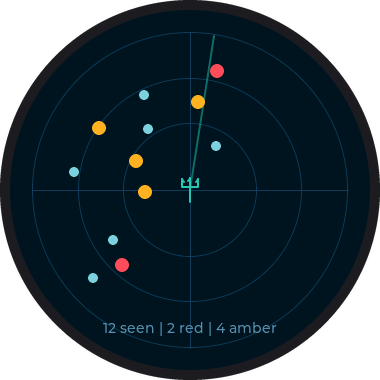 | 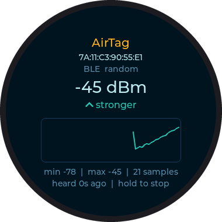 | 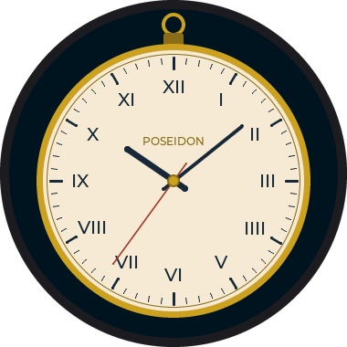 | 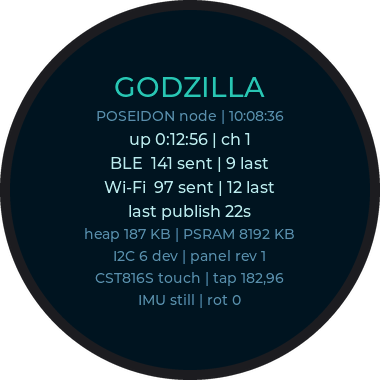 |
| **AMOLED-2.06** | 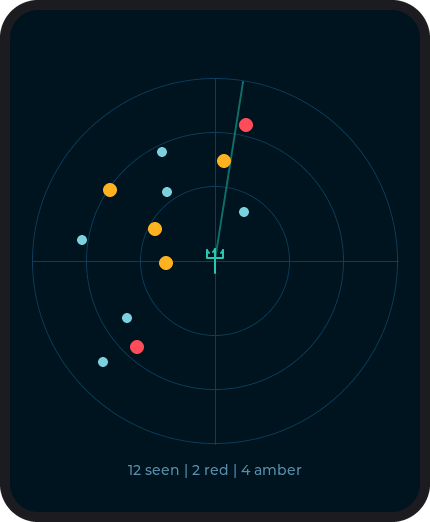 | 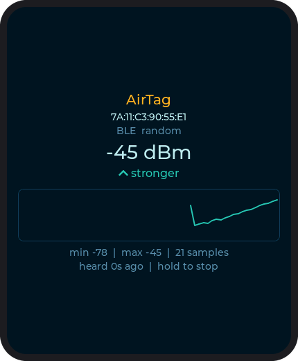 | 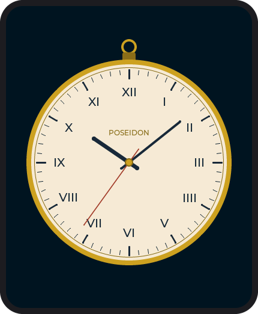 | 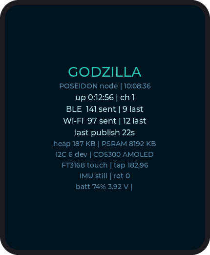 |
| **2.8″ ES3C28P** | 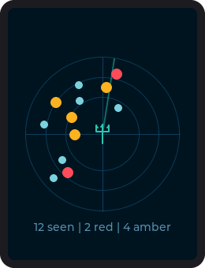 | 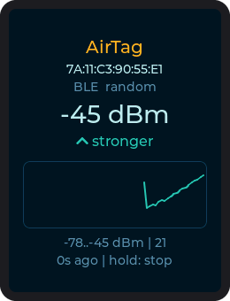 | — | 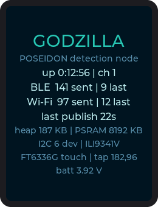 |

Detail card (tap a radar dot): [1.85B](docs/screens/godzilla/185b-card.png) · [AMOLED-2.06](docs/screens/godzilla/amoled206-card.png) · [ES3C28P](docs/screens/godzilla/es3c28p-card.png)

## Screenshots — TRIDENT C5

> Rendered from code at the real 240×135 resolution — [`tools/render_c5_screens.py`](tools/render_c5_screens.py) reproduces the exact draw calls in `src/features/c5_tier2.cpp` with the Deepwater RGB565 palette. Not device photos. The red `ARMED` badge is the TX-arm cue; pixel-exact captures follow the hardware pass.

| Beacon spam | CIW SSID-injection | AP clone (dual-band) |
| :---: | :---: | :---: |
| 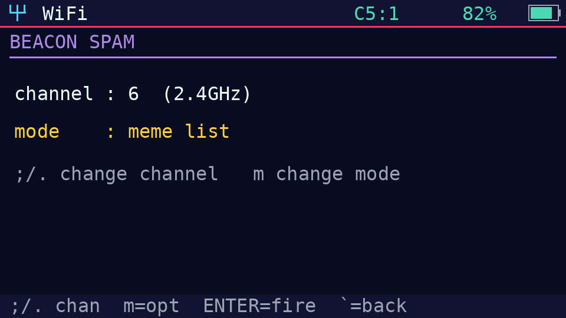 | 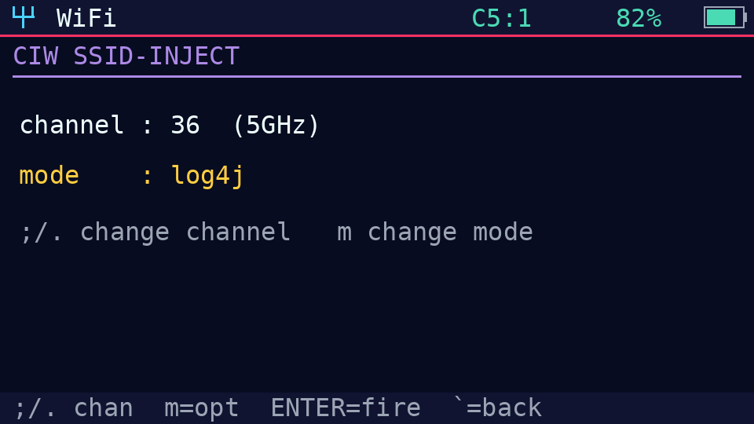 | 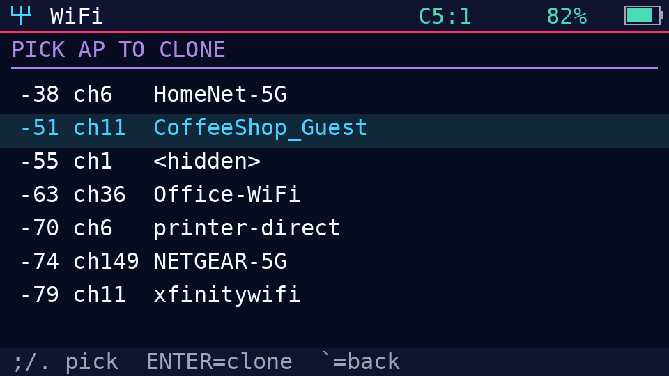 |

Deepwater UI mockups: [node list](assets/screens/c5-nodes.svg) · [dual-band scan](assets/screens/c5-dualband-scan.svg) · [diagnostics](assets/screens/c5-diagnostics.svg) · [TRIDENT PC bridge](assets/screens/trident-bridge.svg)

## What's new — 0.9.2

- **TRIDENT ESP32-C5 command surface is complete.** Every remote action — scan, deauth, PMKID, Zigbee/802.15.4 sniff, probe/deauth/client/spectrum recon, beacon spam, CIW, AP clone, Karma — has a node handler **and** a Cardputer screen.
- **ESP-NOW v2 flag day (wire v5).** Variable-length frames with a **1024-byte** payload (was 230), so a 5 GHz AP scan returns ~23 records per frame instead of ~5 and full EAPOL handshakes fit. See [TRIDENT](#trident-esp32-c5--esp-now-v2).
- **Master TX-arm safety switch.** One SAFE/ARMED gate in front of every offensive transmitter (WiFi / BLE / Sub-GHz / nRF24 / C5), including the in-feature deauth hotkeys and Argus auto-deauth. Passive scan/sniff is never gated. [docs/tx-arm.md](docs/tx-arm.md).
- **PUIE UI.** Unmistakable ARMED status-bar indicator, a reusable C5 live-dashboard widget, and the lab-mode shell.
- **Hardening.** C5 ESP-IDF firmware + native protocol tests now build in CI; cppcheck-clean; release-metadata + partition-table CI guards; 2 MB C5 app partition.

Full detail in [CHANGELOG.md](CHANGELOG.md). One item owed: the on-device v5 validation pass — [docs/hardware-validation.md](docs/hardware-validation.md).

## What's coming

Depth and integration, roughly in order: first-class **pcap/pcapng export** to SD (opens straight in Wireshark), the **educational lab-mode** fleshed out over the shipped shell, **Thread / Matter** observation on the C5's 802.15.4 radio, **cross-radio + GPS** correlation, and the **C5 GPIO expander** ([design spec](docs/specs/2026-11-16-c5-gpio-expander-design.md)). Plus the remaining pre-1.0 items: un-clipped EAPOL and C5 diagnostics Phase B. For **GODZILLA**: the hardware pass (2.8″ board first), a passive BLE-Lab viewer, a three-board bench runbook, and optional alert tones.

## What this fork adds that upstream lacks

[wilcox101-maker/poseidon_adv](https://github.com/wilcox101-maker/poseidon_adv) tracks [Evil0ctopus/poseidon_adv](https://github.com/Evil0ctopus/poseidon_adv) — upstream is the base. The fork-exclusive work, kept as focused commits that replay whole across upstream syncs:

- **Deauth actually goes on air.** The ESP-IDF `ieee80211_raw_frame_sanity_check` filter is identified and defeated — a link-time override on the S3 and a reproducible `libnet80211` binary patch on the C5 — so raw management frames transmit instead of being silently dropped.
- **TRIDENT ESP32-C5 node over ESP-NOW v2.** The entire 5 GHz Wi-Fi + 802.15.4 capability and the v5 wire protocol ([below](#trident-esp32-c5--esp-now-v2)) — nothing like it upstream.
- **GODZILLA detection node** ([above](#godzilla--the-new-detection-node)) — a passive, full-UI node on three ESP32-S3 touch boards, with multi-node detection publishing to the Cardputer, shared Wi-Fi/BLE classifiers and Remote ID decoding from Wi-Fi beacons.
- **Hydra RF cap pin map** — correct PINGEQUA wiring plus shared-SPI arbitration ([below](#hydra-rf-cap-pingequa--works-with-the-bruce-wiring)).
- **Raw AP/STA bring-up hardened** — every `esp_netif` site destroys a stale netif before creating its own, fixing a duplicate-key crash.
- **TX-arm safety system**, the `cardputer-launcher` warning cleanup, CI for both firmwares + native tests, and the release-drift guards.

Counted inventory: [FEATURES.md](FEATURES.md). Live divergence ledger (**+235 / −0** vs upstream): [docs/fork-status.md](docs/fork-status.md).

### Milestone timeline (newest first)

| When | Milestone |
| --- | --- |
| Unreleased (Nov 2026) | **GODZILLA detection node** — passive Wi-Fi/BLE detection head with radar, Hunt, pocket watch, status and microSD Recon, publishing to the Cardputer over ESP-NOW v2 (detection types 60/61, wire v5 unchanged); one tree for three boards (Waveshare 1.85B, Waveshare AMOLED-2.06, 2.8″ ES3C28P); Cardputer `GODZILLA dets` view; shared BLE / Flock classifiers; Remote ID from Wi-Fi beacons. |
| 0.9.2 (Nov 2026) | C5 **Tier 2** TX/SoftAP suite completes the command surface; **ESP-NOW v2 wire v5** flag day (variable-length, 1024-byte payload); **master TX-arm** switch + residual-hotkey gating; **PUIE UI** (ARMED indicator, C5 dashboard widget, lab-mode shell); C5 in CI + native tests; 2 MB C5 partition; release/partition CI guards; flash-tooling + BOOT-pin (GPIO28) fixes. |
| 0.9.1 (Nov 2026) | C5 **Tier 1** passive suite (probe sniff, deauth detect, client hunt, activity sweep) + read-only diagnostics screen; Zigbee-vs-Thread labelling. |
| 0.9.0 (Nov 2026) | **TRIDENT ESP32-C5 companion node** — the only ESP chip here with 5 GHz Wi-Fi + 802.15.4, driven from the Cardputer over ESP-NOW (5 GHz scan / deauth / PMKID, Zigbee sniff). |
| 0.8.0 (Oct 2026) | Raw-AP/STA bring-up hardened — stale-netif destroy before create (duplicate-key crash fix). |
| 0.6.x (May–Jul 2026) | Broad module growth across Wi-Fi / BLE / Sub-GHz / LoRa / IR / LAN; Argus autonomous handshake-hunting Gotchi. |
| 0.4.0 (Apr 2026) | Wi-Fi deauth goes on air — the `ieee80211_raw_frame_sanity_check` filter defeated (S3 link-time override; reproducible C5 `libnet80211` patch). |
| 0.1.0 (Apr 2026) | Initial focused checkout of [Evil0ctopus/poseidon_adv](https://github.com/Evil0ctopus/poseidon_adv). |

## TRIDENT ESP32-C5 — ESP-NOW v2

The Cardputer drives an external **ESP32-C5** over an ESP-NOW bus (root `5`) to reach the radios the host S3 can't: **5 GHz Wi-Fi and 802.15.4**. A 15-action remote surface (scan, 5 GHz deauth, PMKID, Nuke+handshake, Zigbee sniff, the Tier 1 passive recon, diagnostics, and the Tier 2 beacon spam / CIW / AP clone / Karma) streams results back to the handheld. SaltyJack never routes through the C5.

**ESP-NOW v2 (wire v5) is what makes it practical.** v5 moved the project off the old 230-byte frame cap to **variable-length frames with a 1024-byte payload ceiling** — so a 5 GHz AP scan carries ~23 records per frame instead of ~5, full EAPOL handshakes stop being clipped, and new command payloads have headroom. Both chips log `esp_now_get_version()` at boot. **Flash the C5 and the Cardputer together** — v5 and v4 don't interoperate.

## Hydra RF Cap (PINGEQUA) — works with the Bruce wiring

The Hydra RF cap uses the official **PINGEQUA** pin map for the Cardputer ADV — the **same physical wiring Bruce uses** for that hat, so a Hydra hat set up for Bruce works here unchanged. (Poseidon and Bruce are separate firmwares; Poseidon does not read `brucePins.conf`.)

| Signal | GPIO | Role |
| --- | --- | --- |
| SPI SCK / MISO / MOSI | 40 / 39 / 14 | Shared with the microSD |
| CC1101 CS / GDO0 | 13 / 5 | CS is also LoRa-GNSS GPS UART TX |
| nRF24 CS / CE | 6 / 4 | CE is high-Z when the radio is released |
| microSD CS | 12 | Held high while a Hydra radio owns the bus |

`cc1101_park_others()` holds microSD CS and nRF24 CS high before the CC1101 takes the shared bus, and `gps_resume_if_enabled()` restarts the UART/NMEA poller after release. Definitions: `src/cc1101_hw.h`, `src/nrf24_hw.h`, `src/gps.h`; wiring also in [docs/proposals/cc1101-nrf24-hat.md](docs/proposals/cc1101-nrf24-hat.md). Do not seat Hydra and LoRa together — they share SPI with the microSD.

## Hardware notes & cautions

- **The Stamp-S3A has no PSRAM.** The Cardputer-Adv's module is an **ESP32-S3FN8** — 8 MB flash, 512 KB SRAM, **no PSRAM**. If a PlatformIO board/`board_build` profile enables PSRAM, the build/boot will **flag it** (PSRAM init fails, `getPsramFound()` returns false) — that's expected on this hardware, not a fault. Poseidon requires **no PSRAM** by design: no full-screen animation buffers, fixed/pooled draw state throughout.
- **Software-overhead caution.** The Cardputer app already sits at **~85 % of flash** (~2.83 MB of 3.34 MB) and shares the single **512 KB SRAM** pool with the WiFi/BLE stacks and the display. New features must stay lean — prefer fixed buffers over heap/`String`, keep large assets on the SD card, and watch `System → Heap`. Headroom is small; budget it.

## Deepwater interface

Keyboard-first UI for the 240×135 display: a ~900 ms skippable boot reveal, terminal and carousel layouts, letter-mnemonic menus with `;`/`.` nav and `?` help, early-dismissable notices, and confirmation on destructive actions. `System → Display` toggles motion (`M`), large text (`B`) and ambient decoration (`A`); reduced motion pauses decoration, not live measurements. **TX safety:** `System → Settings → T` (default **SAFE**) gates every offensive transmitter; the status bar shows a red `ARMED` badge while armed. No PSRAM required.

**Eleven themes:** POSEIDON (navy/ice/cyan, default), MATRIX, E-INK, SYNTHWAVE, PHANTOM, BLOOD, AMBER CRT, NIGHT CITY, SOLARIS, NORDIC FROST, GHOST PURPLE.

## SaltyJack & networking

Authorized use only — networks and hardware you own or have written permission to test. **STA path** (Cardputer joins an AP): DHCP Starve, Rogue DHCP (STA), Responder, WPAD — works now. **SoftAP path**: Rogue DHCP (AP) via the open `POSEIDON-SaltyJack` AP — works now. **W5500 RJ45**: hardware-ready, driver not wired in this tree — use STA until it lands. **C5**: radio work only, never SaltyJack. Full how-to (STA vs SoftAP, pins, hat conflicts, troubleshooting): [docs/saltyjack-networking.md](docs/saltyjack-networking.md).

## Quick start & install

- **Standalone (recommended):** web-flash the Deepwater factory image — [docs/flash/](docs/flash/index.html) or [M5Stack WebBurner](https://burner.m5stack.com/). `poseidon-factory.bin` goes at `0x0`; don't factory-flash a Launcher layout.
- **Launcher:** install `poseidon-launcher.bin` via Launcher's app installer. For raw flashing, read the **real** partition table and target the actual slot — don't assume a fixed offset.
- **TRIDENT C5:** web-flash [docs/flash/](docs/flash/index.html), target **TRIDENT — C5** (bins at `0x2000` bootloader, `0x8000` table, `0x10000` app). Flash it **with** the Cardputer so both run v5.
- Full target → use-case → install reference: [docs/firmware-targets.md](docs/firmware-targets.md).

## Building & validation

```text
pio run -e cardputer -e cardputer-ota -e cardputer-launcher -e cardputer-launcher-dual
pio run -e godzilla -e godzilla-amoled206 -e godzilla-es3c28p   # GODZILLA: 1.85B, AMOLED-2.06, ES3C28P
pio test -e native-test
idf.py -C c5_node build          # TRIDENT C5 — ESP-IDF >= 5.5, target esp32c5
```

CI builds every Cardputer profile and all three GODZILLA boards, compiles `c5_node/`, and runs the native unit tests (protocol layout included) on each push/PR, so a C5 break surfaces in CI, not at flash time. Release packaging (after building the profiles): `scripts/prepare_deepwater_release.ps1 -Version <x.y.z>` refreshes `release_binaries/` + SHA256 sums. On-device UI smoke test: `scripts/test_deepwater_ui.ps1 -Port COM<n>`.

> **C5 build note:** if a local C5 build reports a 1 MB app partition, delete the stale generated `c5_node/sdkconfig` and rebuild — it overrides `sdkconfig.defaults` (which selects the 2 MB custom table), and `idf.py fullclean` does not remove it. A fresh checkout / CI is always correct.

## Acknowledgments & Shoutouts

- **[@Evil0ctopus](https://github.com/Evil0ctopus)** — upstream POSEIDON (fork origin)
- **[@7h30th3r0n3](https://github.com/7h30th3r0n3)** — Evil-M5Project and RaspyJack (SaltyJack LAN toolkit inspiration)
- **[@justcallmekoko](https://github.com/justcallmekoko)** — ESP32Marauder wireless research / promiscuous-mode frameworks
- **[@bmorcelli](https://github.com/bmorcelli)** — M5Burner firmware browser and webflasher
- **[@pr3y](https://github.com/pr3y)** — Bruce hardware reference implementations
- **[@UberGuidoZ](https://github.com/UberGuidoZ)** — Flipper Sub-GHz signal libraries
- **[@M5Stack](https://github.com/M5Stack)** — hardware design and SDKs
- **[Valleytech Custom Solutions](https://github.com/valleytechsolutions)** (Your Pal Kal) — [Dragon Detector](https://github.com/valleytechsolutions/Dragon-Detector) (MIT), whose feature set the GODZILLA node reimplements natively; no Dragon Detector source, binaries or artwork are included

---

## Safety / Authorized Use

**POSEIDON is an educational wireless-auditing lab for security research on hardware and networks you own or have explicit permission to test.**

- Use only on **your own equipment** or systems where you have **written authorization**.
- Do **not** use this firmware for unauthorized access, interference, jamming, or disruption of third-party networks or devices.
- You are responsible for complying with local radio and computer-misuse laws (FCC / Ofcom / ETSI and equivalents).
- Captured data (handshakes, probes, logs) may include personal information — handle it lawfully.

If you are unsure whether a use is allowed, treat it as **not allowed**. See the upstream [Legal & Responsible Use](https://github.com/Evil0ctopus/poseidon_adv/blob/master/docs/legal.html) page for fuller guidance.
